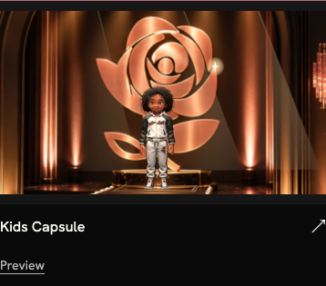

# Kids Capsule R10 — main-compatible PR

This PR ports the accepted R10 visuals from release commit39be71dc9 onto main7a31ed0d0. It does not merge the successor branch’s136 older commits or change the live site.

The source-gate implementation remains main’s existing architecture. Kids adds its exact asset/receipt validation, poster selection on homepage/menu, one-shot playback, full-frame layout and Replay below the film. No successor runtime manifest, product sizing, Three.js or broader navigation changes are imported. Adult collection markup remains unchanged apart from whitespace.

The following deployment record and738-file map describe the already-deployed successor release, **not the tree built by this PR**. The six media files are byte-identical. Main-specific qualification is recorded separately below.

## Reproduce main-specific checks

```sh
php tasks/kids-cinematic-hero-20261022/test-r10-media-gate.php wordpress-theme/skyyrose-flagship-2
php tasks/kids-cinematic-hero-20261022/test-r10-media-integrity.php wordpress-theme/skyyrose-flagship-2
npm ci --ignore-scripts --prefix wordpress-theme/skyyrose-flagship-2
npm run check:assets --prefix wordpress-theme/skyyrose-flagship-2
node tasks/kids-cinematic-hero-20261022/check-integration-main-r10.cjs
```

The browser check needs Playwright and Chromium. Optional `PLAYWRIGHT_MODULE`, `CHROME_PATH` and `PHP_BIN` select installed tools. It uses local synthetic WordPress adapters with real templates, assets, gates and controllers; all external requests are blocked. It does not qualify an installed WordPress stack or redeploy production. New results are in `main-qualification.json`.

## Historical deployed release


Corey accepted R10 and authorized publication: “looks good now push this to production on the homepage kids page and menu. keep the rollback and verify it looks right on mobile too”.

Published to https://skyyrose.co/ and https://skyyrose.co/collections/kids-capsule/, including the navigation Kids card and larger preview. The film uses a slow platform rise and close camera ending on Skyy and the rose, with lights and statue glints. It holds its ending until Replay; reduced motion uses the closing poster.

## Release identity

- Current installable package SHA256: `5144b215a02574e6c76babdba29efa347b757147acf78009bad9c3b480037c26`.
- Exact738-file deployed map: [deployed-files.json](deployed-files.json).
- Source authoring files and media reviews are also committed; they are excluded from the production ZIP by the package boundary. Their historical integration approval remains byte-for-byte hash bound. This publication acceptance supersedes their earlier preview-pending notes without rewriting historical evidence.
- R9 media remains because it is in the verified package; active placements select R10.
- Original R10 package was installed through authenticated SSH, then one template was atomically corrected for mobile Replay clearance. Current live hashes match the v2 ZIP retained locally.

## Verification

Eleven live browser cases passed at390,768 and1440 pixels: actual R10 playback, ordinary pause/resume/replay, ending and reentry hold, full-frame display, menu preview/focus and reduced motion. Zero JavaScript errors. These are Chrome viewport-emulation checks, not physical-device coverage. [Browser evidence](browser-checks.json) and [independent review](independent-review.md).

The mobile Replay control was moved below the film to clear the fixed header. Initial stale-cache failures and the prior Replay interception remain in local deployment evidence; final run is live-r4.

Existing saved-order count and immutable history/boundary state matched before and after. No live orders, payments or consent actions were performed. No additional generation credits were spent. This is visual deployment qualification, not new checkout/payment/privacy acceptance.

## Rollback

The protected immediate732-file prior theme and older810-file rollback remain on the server; hashes rechecked and HTTP access denied. Original R10 arrival.php is separately retained with private permissions. [Rollback verification](rollback-verification.json). Before any rollback, revalidate the authenticated target and reconcile current and late orders; never delete or rebaseline immutable order history or boundary options.

## Mobile captures




The local package, native master, full render history, failed experiments and operational deployment scripts remain retained outside this bounded source commit. The seven pre-existing product/catalog edits are excluded and unchanged.

## Historical release39be commit validation exception

The historical frozen deployment snapshot used a command-scoped read-only precommit hook to preserve its reviewed bytes. The normal mutating Prettier/PHPCBF steps were intentionally omitted, not claimed passed. Compensating checks verify staged blobs against the738-file deployed map, authoring/runtime parity, media receipt hashes, PHP/JavaScript/JSON syntax, source-gate cases, registry projections, freshness and default secret scanning. The branch-owned pre-push checks remain in place; global hook configuration is unchanged.

## Main-port commit validation

The main-port commit also uses a command-scoped read-only hook to avoid rewriting hash-bound media receipts. Prettier/PHPCBF mutation is omitted, not claimed passed. Main qualification checks replace the historical738-file parity check: unchanged existing inventory records, six unchanged media hashes, source-gate and isolated integrity tests, PHP/JavaScript/JSON syntax, pinned asset build, registry/freshness and default secret scanning. No full production-tree parity is claimed for this adaptation.

## PR review repairs

The valid Kids poster survives missing or tampered video files on the homepage, collection arrival, navigation and existing Lookbook. Poster-only arrivals emit no motion control. Navigation resolves only the poster, avoiding video hashing on every route. The Lookbook retains its Kids film through the new resolver and uses the same one-shot ending. Adult branches remain unchanged.

The validator now recognizes controlled native Kids rendering through the runtime receipt gate, requires one coherent receipt for all three assets, and keeps integration authority separate from AI creative approval. Thirty validator tests and eleven isolated integrity cases pass. `main-runtime-reconciliation.json` records only the six affected PHP baseline hashes and their main lineage. These are local source checks, not new deployment evidence.
